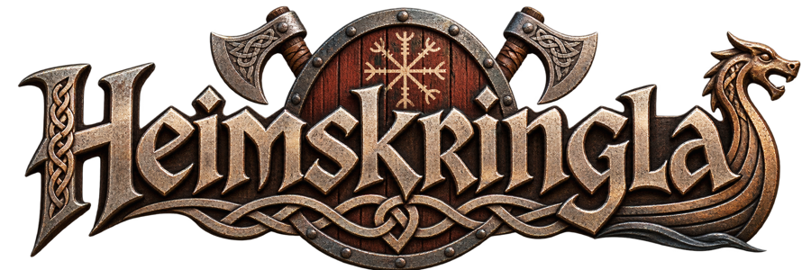
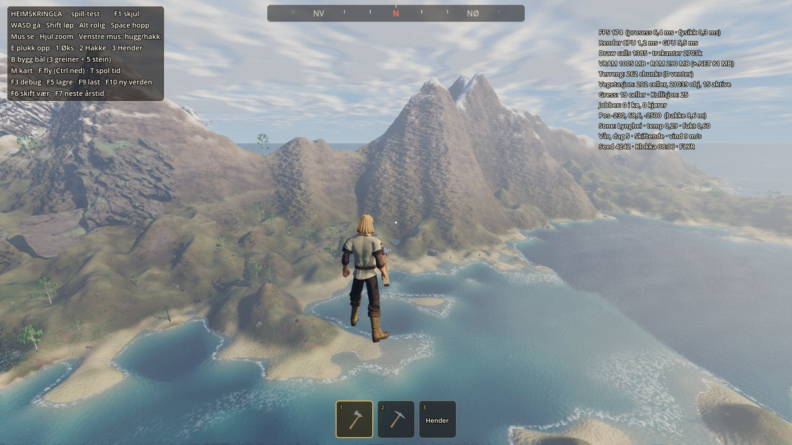
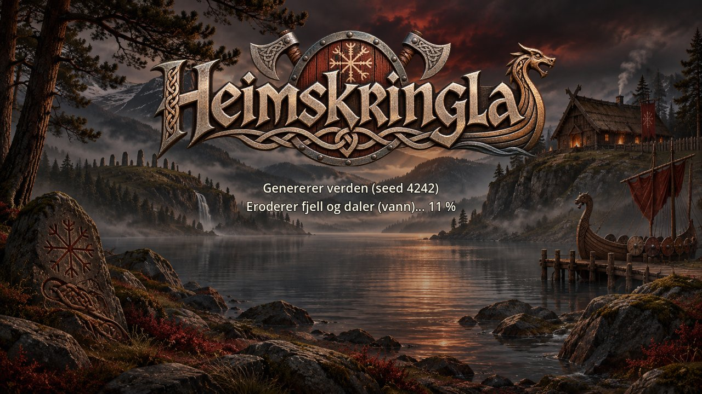
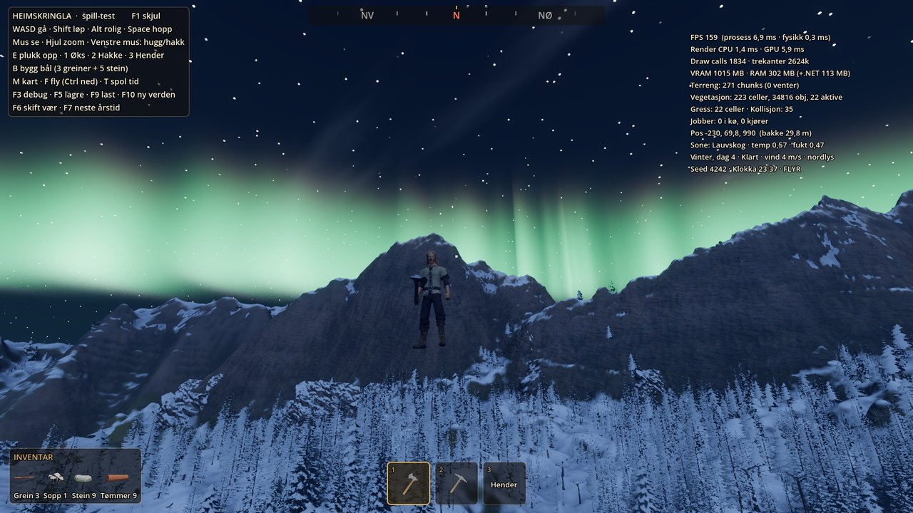
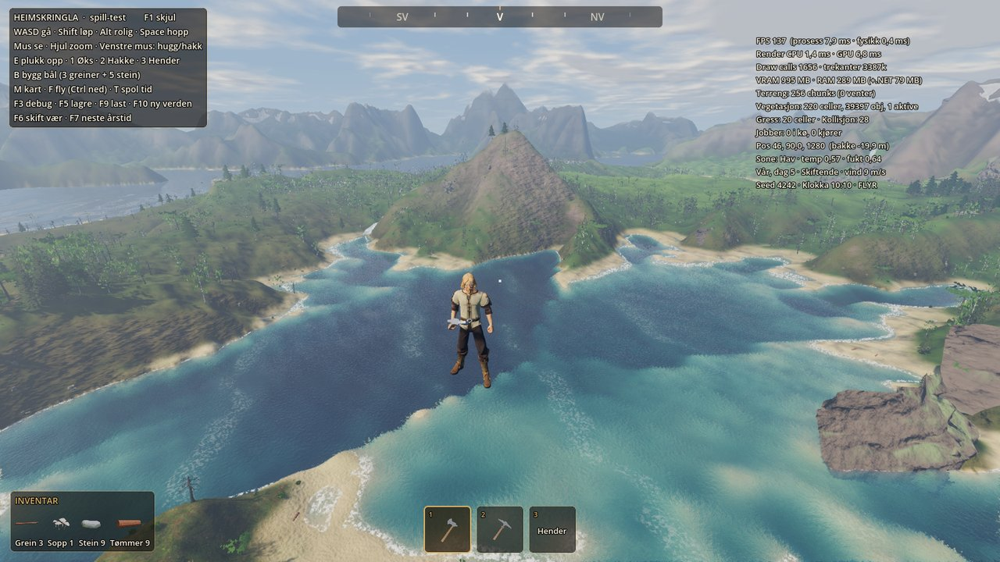
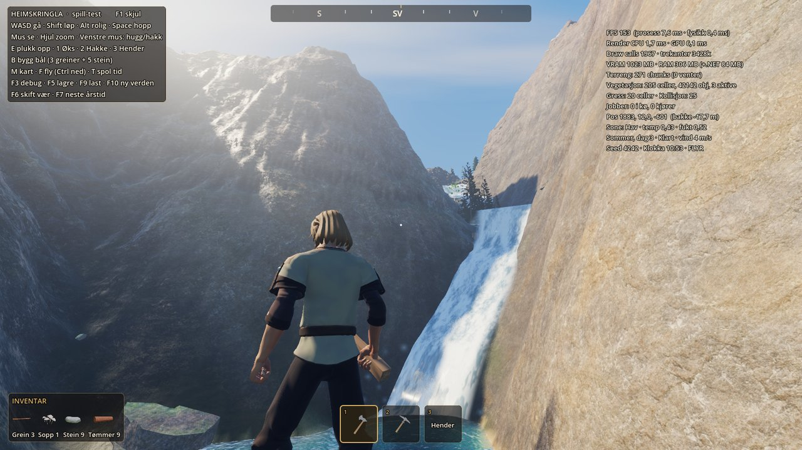
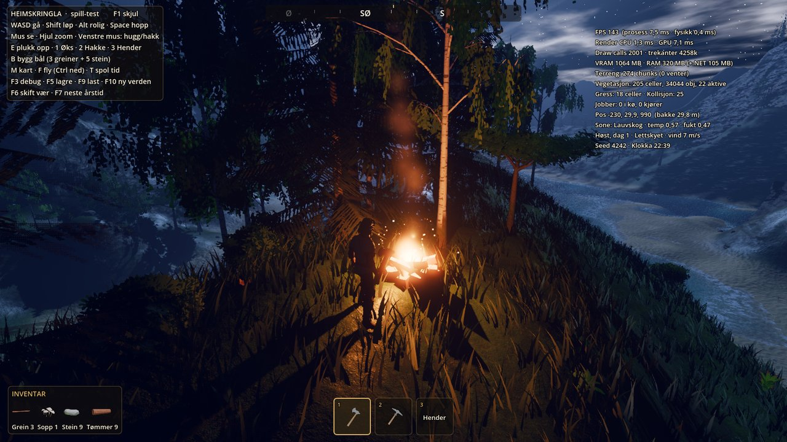
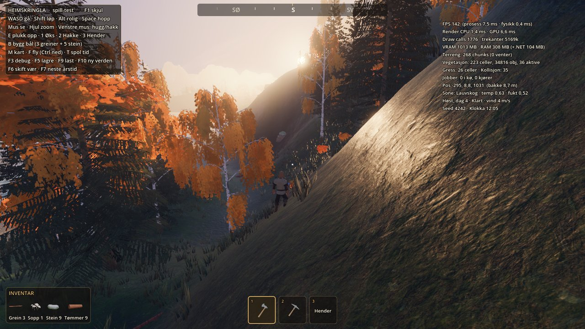

<p align="center">
  
</p>

<p align="center">
  <em>A Viking-age survival game set in a large, procedurally generated Norwegian landscape.</em>
</p>

<p align="center">
  
  
  
  
  
  
  
</p>

<p align="center">
  
</p>

---

**Heimskringla** (Old Norse for *"the circle of the world"*) is a survival game in early development. You wander a
finite ~10 × 10 km world of fjords, birch and spruce forest, mountains and coastline, gather wood and stone, light a
fire and try to get through the seasons. The world is generated from a seed, with a climate that goes from mild in
the south to snow and ice in the north.

The project is currently a technical prototype: the focus so far has been on making a large world that looks and
feels like Norwegian nature, and runs well.

## Screenshots

| | |
|---|---|
|  |  |
|  |  |
|  |  |

## Features

**World**
- Procedural 10 × 10 km island world from a seed, surrounded by ocean
- Heightmap terrain in chunks with quadtree LOD, hydraulic and thermal erosion
- Rivers, lakes, waterfalls and a wave-animated ocean
- Climate gradient from south to north: meadows, deciduous and conifer forest, heath, bog, scree and snow
- PBR terrain textures with masks for gullies, hollows and ridges, plus scanned cliff faces

**Nature and atmosphere**
- Procedurally generated Norwegian spruce, silver birch and oak, with wind animation
- Dense grass and undergrowth that bends in the wind
- Day/night cycle, custom sky with clouds and cloud shadows, fog banks and volumetric fog
- Weather (clear, cloudy, overcast, rain, storm, fog — snow in winter) and four seasons with autumn colours and snow cover
- Northern lights on clear winter nights
- Recorded wind ambience that follows the landscape and weather

**Gameplay (so far)**
- Third-person character with foot IK and footprints
- Chop trees (by size and skill) and mine rocks; pick up branches and stones
- Build a campfire
- World map, save/load
- Intro, main menu, settings and pause menu
- English and Norwegian (Bokmål); follows the system language, switchable in Settings

## Getting started

### Requirements
- Windows 10/11
- [.NET 8 SDK](https://dotnet.microsoft.com/download/dotnet/8.0)
- [Godot 4.7.2 .NET (mono)](https://godotengine.org/download/) — unpack it to
  `tools/Godot_v4.7.2-stable_mono_win64/` (the `tools/` folder is git-ignored)
- A reasonably modern GPU (the game uses the Forward+ renderer)

### Run

```bat
run.cmd          :: build and run with a random world
run.cmd 1234     :: build and run with seed 1234
editor.cmd       :: open the project in the Godot editor
```

### Controls

| Key | Action |
|---|---|
| `W` `A` `S` `D` | Move |
| `Shift` / `Alt` | Run / walk |
| `Space` | Jump |
| Mouse / wheel | Look / zoom |
| Left mouse | Chop / mine |
| `E` | Pick up |
| `1` `2` `3` | Axe / pickaxe / hands |
| `B` | Build campfire (3 branches + 5 stones) |
| `M` | Map |
| `F` | Toggle fly mode (`Ctrl` to descend) |
| `T` | Fast-forward time |
| `F1` / `F3` | Help / debug overlay |
| `F5` / `F9` | Save / load |
| `F6` / `F7` | Next weather / next season |
| `F10` | New world |

## Automated testing

`scripts/autotest.sh` runs a scripted fly-through of the world: it visits different biomes, fells a tree, mines a
rock, cycles weather and seasons, saves screenshots and logs performance.

```bash
scripts/autotest.sh out/ 4242   # output folder, optional seed
```

See the header of the script for environment variables that turn individual features off for debugging.

## Localization

Player-facing text lives in `translations/*.csv` (columns `keys,en,nb`) and is looked up with
`Loc.T("KEY")` / `Loc.F("KEY", args)`. English is the fallback. To add a language, add a column and
an entry in `Loc.Languages`. Set `HK_LANG=en|nb` to force a language when testing.

## Releasing

```bash
scripts/release.sh                    # build build/heimskringla-YYYY-MM-DD-X.Y.Z.zip (patch bump from last tag)
scripts/release.sh 0.2.0 --publish    # build, tag v0.2.0, push and create a GitHub release
```

Optionally pass `--notes <file.md>` for the release notes; otherwise the commit list since the previous tag is used.

## Project structure

```
src/
  Core/         Game state, settings, save data, job queue, model library
  World/        World generation, erosion, climate
  Terrain/      Chunked heightmap terrain, LOD, collision, textures
  Vegetation/   Procedural trees, grass and placement
  Environment/  Day/night, weather and seasons, ocean, waterfalls, ambience
  Gameplay/     Player, character model, interaction, campfire
  UI/           HUD, map, menus
shaders/        Terrain, water, sky, vegetation and effect shaders
scripts/        Asset import/fetch helpers and the autotest runner
assets/         Models, textures, audio and fonts (see assets/LICENSES.md)
```

## License

The source code and original artwork (logo, icon and loading-screen art) are released under the
[MIT License](LICENSE). Third-party assets keep their own licenses — see below.

Contributions are welcome — see [CONTRIBUTING.md](CONTRIBUTING.md).

## Credits

All third-party assets are CC0 (public domain) unless stated otherwise — see [`assets/LICENSES.md`](assets/LICENSES.md).
Thanks to [Quaternius](https://quaternius.com), [Kenney](https://kenney.nl), [ambientCG](https://ambientcg.com),
[Poly Haven](https://polyhaven.com) and the [Freesound](https://freesound.org) contributors. The Cinzel font is
licensed under the SIL Open Font License 1.1.

Built with [Godot Engine](https://godotengine.org).
